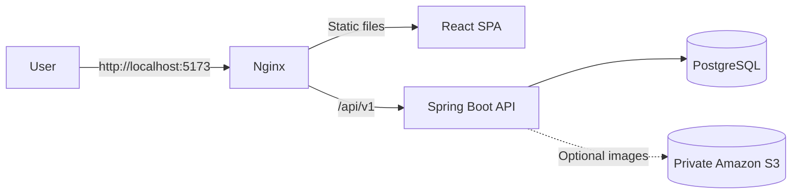
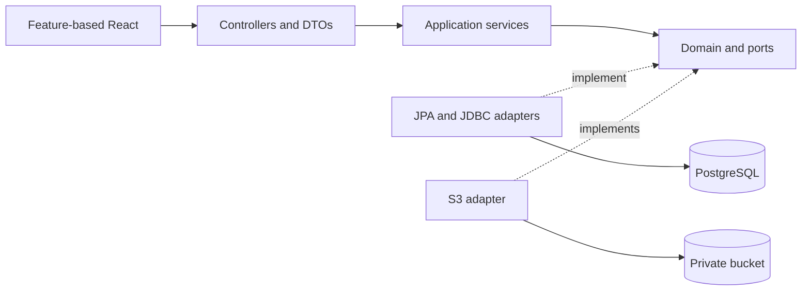
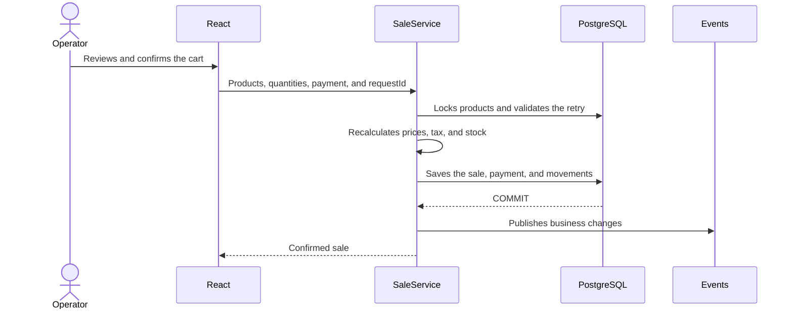
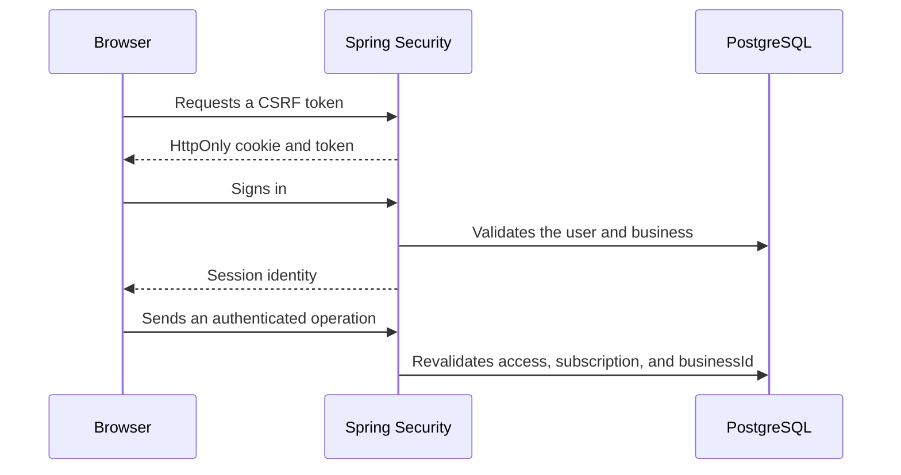
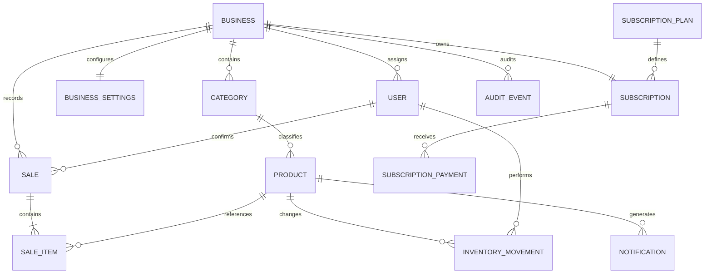

# Kivo

[Español](README.md) | **English**

<p align="center">
  
</p>

<p align="center">
  Multi-tenant product, inventory, sales, and subscription management.
</p>

Kivo is a web application for managing the daily operations of small businesses.
Each business works in an isolated workspace with its own catalog, inventory,
sales, settings, and users. A separate platform administration panel manages
businesses, plans, and subscriptions.

The project follows a modular monolith architecture with a React interface, a
Spring Boot API, and a PostgreSQL database. It can run as a complete environment
with Docker Compose or as separate components during development.

> [!IMPORTANT]
> Kivo receipts are internal documents. This version does not issue electronic tax
> receipts or connect directly to Chile's SII or payment terminals.

## Contents

- [Overview](#overview)
- [Features](#features)
- [Architecture](#architecture)
- [Data model](#data-model)
- [Repository structure](#repository-structure)
- [Technology stack](#technology-stack)
- [Requirements](#requirements)
- [Download and start](#download-and-start)
- [How to use Kivo](#how-to-use-kivo)
- [Configuration](#configuration)
- [Development without Docker](#development-without-docker)
- [Tests and quality](#tests-and-quality)
- [Security](#security)
- [Production preparation](#production-preparation)
- [Additional documentation](#additional-documentation)
- [License](#license)

## Overview

Kivo provides two workspaces:

| Workspace               | User            | Responsibility                                            |
| ----------------------- | --------------- | --------------------------------------------------------- |
| Platform administration | `SUPER_ADMIN`   | Businesses, access, plans, subscriptions, and payments    |
| Business operations     | `BUSINESS_USER` | Products, inventory, sales, reports, alerts, and settings |

Each business can operate in one of these modes:

| Mode             | Behavior                                                        |
| ---------------- | --------------------------------------------------------------- |
| `POS`            | Records sales, internal payments, receipts, and stock movements |
| `INVENTORY_ONLY` | Records inventory withdrawals without creating sales or revenue |

There is no public registration. The platform administrator creates the business
and its user accounts. Each person receives a temporary password and must change
it after signing in.

## Features

### Platform administration

- Create, edit, activate, and suspend businesses.
- Create business users and reset their access.
- Create and edit plans.
- Assign, change, suspend, and reactivate subscriptions.
- Trial periods, expiration dates, and grace periods.
- Manual subscription payment registration and confirmation.
- Theme and language preferences.

### Business operations

- Categories and products with barcodes, prices, images, and minimum stock.
- Stock entries, withdrawals, adjustments, returns, and inventory history.
- Point of sale with search by name or barcode.
- Support for HID scanners that work as keyboards.
- A cart that remains available while navigating within the browser session.
- Atomic sales with price, stock, and idempotency validation.
- Sale cancellation with stock restoration.
- Printable internal receipts with the Kivo logo.
- Reports by period, best-selling products, and current stock.
- Low-stock alerts in the notification bell.
- View updates through SSE events after a change is committed.
- Light and dark themes with Spanish, English, and Chinese interfaces.
- Responsive layouts for desktop, tablet, and mobile devices.

### Key rules

- Business data is always queried using the company from the authenticated session.
- The browser does not provide a business identifier to determine data scope.
- Amounts and taxes are recalculated on the server.
- A sale cannot produce negative stock.
- Retries with the same identifier do not duplicate sales or movements.
- Disabling a product or category preserves its history.

## Architecture

### Local topology



Nginx serves the compiled application and forwards API requests. The browser uses
a single origin, while the backend and PostgreSQL remain on internal Compose
networks. Locally published ports listen only on `127.0.0.1`.

### Internal design



The backend applies a pragmatic clean architecture inside a modular monolith:

- **Presentation:** receives HTTP requests, validates their shape, and maps DTOs.
- **Application:** coordinates use cases, transactions, and permissions.
- **Domain:** contains models, rules, and contracts without depending on JPA.
- **Infrastructure:** implements persistence, security, storage, and SSE.

This separation allows a rule or adapter to change without moving infrastructure
details into controllers. The implementation uses constructor injection,
repositories, payment strategies, adapters, and domain events.

### Backend modules

| Module          | Responsibility                                                    |
| --------------- | ----------------------------------------------------------------- |
| `auth`          | Sign-in, sign-out, CSRF, current identity, and attempt limiting   |
| `businesses`    | Business administration                                           |
| `users`         | Users, temporary passwords, and access status                     |
| `billing`       | Plans, subscriptions, expiration, and platform payments           |
| `categories`    | Catalog classification                                            |
| `products`      | Products, prices, search, and images                              |
| `inventory`     | Stock, movements, and confirmed withdrawals                       |
| `sales`         | Sales, line items, idempotency, and cancellations                 |
| `payments`      | Sale payment methods                                              |
| `documents`     | Internal receipts and a contract for a future tax document issuer |
| `reports`       | Aggregate queries by business and period                          |
| `settings`      | Operating mode, taxes, scanner, and document settings             |
| `notifications` | Minimum-stock alerts                                              |
| `realtime`      | Business-isolated SSE events                                      |
| `storage`       | Optional image validation and storage                             |
| `shared`        | Errors, pagination, auditing, and cross-cutting utilities         |

### Sale flow



If a price changes after the cart is reviewed, the API returns the current total
and requires a new confirmation. Events are emitted after `COMMIT`, so a view is
never updated from a rolled-back operation.

### Session and tenant isolation



Sessions are opaque, stored in PostgreSQL, and expire after inactivity. Changing
a user's status or access version invalidates previous sessions.

## Data model



Sale items preserve copies of the product name, category, and price used at
confirmation time. Historical reports therefore remain consistent even when the
catalog changes later. Flyway migrations create and evolve this model
automatically.

## Repository structure

```text
.
├── backend/
│   ├── src/main/java/com/stockflow/
│   │   ├── auth/                 Authentication and security
│   │   ├── billing/              Plans and subscriptions
│   │   ├── businesses/           Businesses
│   │   ├── categories/           Categories
│   │   ├── documents/            Receipts
│   │   ├── inventory/            Stock and movements
│   │   ├── notifications/        Alerts
│   │   ├── payments/             Sale payments
│   │   ├── products/             Catalog
│   │   ├── realtime/             SSE
│   │   ├── reports/              Metrics
│   │   ├── sales/                Sales
│   │   ├── settings/             Business settings
│   │   ├── storage/              Images
│   │   ├── users/                Users
│   │   └── shared/               Shared components
│   ├── src/main/resources/
│   │   └── db/migration/         Flyway-versioned schema
│   └── src/test/                 Unit and integration tests
├── frontend/
│   ├── public/
│   │   ├── fondos/               Optimized backgrounds
│   │   └── logos/                WebP brand assets
│   ├── src/
│   │   ├── app/                  Router, providers, and shell
│   │   ├── features/             Business-oriented screens
│   │   ├── locales/              Translations
│   │   ├── shared/               API, types, and reusable components
│   │   └── styles/               Tokens, themes, and responsive design
│   └── e2e/                      Full browser journeys with Playwright
├── docs/                         Architecture, API, and maintenance
├── infrastructure/               Planned AWS deployment guide
├── scripts/                      Local setup and backend tasks
├── .github/workflows/ci.yml      Continuous integration
├── docker-compose.yml            Complete local environment
└── .env.example                  Public template without secrets
```

The `com.stockflow` Java namespace and some historical technical identifiers are
kept to avoid unnecessary migrations. The brand shown in the interface and
documentation is **Kivo**.

## Technology stack

| Area           | Main technologies                                                                                           |
| -------------- | ----------------------------------------------------------------------------------------------------------- |
| Frontend       | React 19, TypeScript 5.9, Vite 7, React Router, TanStack Query, React Hook Form, Zod, i18next, and Recharts |
| Backend        | Java 25, Spring Boot 4.1, Spring Security, Spring Data JPA, Hibernate, and Maven                            |
| Data           | PostgreSQL 17, Flyway, and Spring Session JDBC                                                              |
| Infrastructure | Docker Compose, unprivileged Nginx, and an Amazon S3 adapter                                                |
| Quality        | JUnit, Testcontainers, Vitest, Testing Library, Playwright, ESLint, Prettier, and Spotless                  |

## Requirements

### Recommended setup

- [Git](https://git-scm.com/)
- [Docker Desktop](https://www.docker.com/products/docker-desktop/) or Docker Engine
  with the Compose plugin
- [Node.js 24 LTS](https://nodejs.org/) to generate the local configuration

### Component-based development

You will also need:

- Java 25
- Maven 3.9
- npm, included with Node.js

## Download and start

### 1. Download the project

```powershell
git clone https://github.com/YOUR_USER/YOUR_REPOSITORY.git
cd YOUR_REPOSITORY
```

Replace the URL with the actual repository address.

### 2. Create the local configuration

With Docker Desktop running, execute this command from the project root:

```powershell
node scripts/setup-local.mjs
```

The script creates `.env` once from [`.env.example`](.env.example), generates
random passwords, and does not print them to the terminal. If `.env` already
exists, the script preserves it.

### 3. Build and start Kivo

```powershell
docker compose --profile app up --build -d
```

The first run can take a few minutes while Docker downloads images and builds the
application.

### 4. Open the application

Visit [http://localhost:5173](http://localhost:5173).

Local credentials are stored in `.env`:

- Administrator: `BOOTSTRAP_ADMIN_EMAIL` and `BOOTSTRAP_ADMIN_PASSWORD`.
- Demo business user: `DEMO_USER_EMAIL` and `DEMO_USER_PASSWORD`.

Do not publish or share the contents of this file.

### 5. Check the environment

```powershell
docker compose ps
docker compose logs -f backend frontend
```

The API also provides a minimal public health check at
[http://localhost:8080/api/v1/health](http://localhost:8080/api/v1/health).

### Stop or restart

```powershell
docker compose --profile app down
```

This command preserves PostgreSQL data. To start the environment again:

```powershell
docker compose --profile app up -d
```

> [!CAUTION]
> `docker compose down -v` removes the volume and all local data. Use it only when
> you intend to recreate the environment from scratch.

### Local services

| Service    | Address                        | Purpose                           |
| ---------- | ------------------------------ | --------------------------------- |
| Interface  | `http://127.0.0.1:5173`        | Browser application               |
| API        | `http://127.0.0.1:8080/api/v1` | Local development and diagnostics |
| PostgreSQL | `127.0.0.1:5432`               | Local development tools           |

Use either `localhost:5173` or `127.0.0.1:5173` consistently during a session.
Cookies belong to the hostname in use, so alternating between them can end the
session.

## How to use Kivo

### First platform administrator access

1. Sign in with the `BOOTSTRAP_ADMIN_*` variables.
2. Create or review plans under **Plans**.
3. Create a business and choose its trial period or subscription.
4. Create the business user with a temporary password.
5. Record and confirm payments when applicable.
6. Suspend or reactivate access from the administration panel.

### First business access

1. Sign in with the `DEMO_USER_*` variables or a newly created account.
2. Change the temporary password when requested.
3. Review **Settings**: operating mode, tax, alerts, and receipts.
4. Create categories, followed by products.
5. Record entries or adjustments to establish initial stock.
6. Confirm sales in `POS` mode or withdrawals in `INVENTORY_ONLY` mode.
7. Review movements, notifications, and reports.

The pending cart remains available when moving between screens in the same tab.
An already submitted operation with an uncertain result is also preserved, so it
can be retried with the same identifier without duplicating data.

## Configuration

The repository includes only a public template. The real `.env` file is excluded
from Git and from Docker build contexts.

| Variable                                            | Description                                    |
| --------------------------------------------------- | ---------------------------------------------- |
| `POSTGRES_DB`                                       | Local database name                            |
| `POSTGRES_USER`, `POSTGRES_PASSWORD`                | PostgreSQL credentials                         |
| `DB_URL`, `DB_USER`, `DB_PASSWORD`                  | Backend JDBC connection                        |
| `SPRING_PROFILES_ACTIVE`                            | `dev` enables local demonstration data         |
| `APP_ALLOWED_ORIGIN`                                | Exact origin allowed by CORS                   |
| `APP_COOKIE_SECURE`                                 | Must be `true` when the application uses HTTPS |
| `APP_TRUSTED_PROXIES`                               | Exact addresses of trusted proxies             |
| `BOOTSTRAP_ADMIN_EMAIL`, `BOOTSTRAP_ADMIN_PASSWORD` | Initial administrator                          |
| `DEMO_USER_EMAIL`, `DEMO_USER_PASSWORD`             | Business access for the `dev` profile          |
| `VITE_API_URL`                                      | Public API path, normally `/api/v1`            |
| `AWS_REGION`, `S3_BUCKET`                           | Optional private image storage                 |

Changing an existing user's password in `.env` does not update the stored
password. Reset access through the administration panel, or recreate the volume
when working with a disposable local environment.

When `S3_BUCKET` is empty, the catalog works without image uploads. AWS
credentials come from the standard SDK credential chain or an assigned role and
are never sent to the frontend.

## Development without Docker

### Database

```powershell
docker compose up -d postgres
```

### Backend

From the project root:

```powershell
./scripts/backend.ps1 run
```

The script loads `.env` and uses an installed Maven version or the local copy
available under `.tools`.

### Frontend

In another terminal:

```powershell
cd frontend
npm ci
npm run dev
```

Vite opens the interface at `http://127.0.0.1:5173` and proxies `/api` to
`localhost:8080`.

## Tests and quality

### Backend

Fast unit tests:

```powershell
./scripts/backend.ps1 test
```

Complete verification, including PostgreSQL through Testcontainers:

```powershell
./scripts/backend.ps1 verify
```

### Frontend

```powershell
cd frontend
npm ci
npm run format:check
npm run lint
npm test
npm run build
```

### Browser journeys

With the local application running:

```powershell
cd frontend
npx playwright install chromium
npm run test:e2e
```

Files under `frontend/e2e/` automate real user actions in a browser: signing in,
navigating, filling in forms, and checking results. They detect problems between
the frontend, API, and database that an isolated test cannot observe.

The [`.github/workflows/ci.yml`](.github/workflows/ci.yml) workflow runs repository
checks, formatting, linting, tests, and builds on every `push` and `pull_request`.

## Security

- `HttpOnly` session cookie and CSRF token for write operations.
- Session rotation after sign-in.
- PostgreSQL-backed sessions with inactivity expiration.
- Sign-in attempt limiting.
- Hashed password storage.
- Role-based authorization and user, business, and subscription revalidation.
- Business queries scoped by `businessId`.
- Image validation and re-encoding before S3 upload.
- Auditing of relevant administrative and business operations.
- Local secrets excluded through `.gitignore` and `.dockerignore`.

The vulnerability reporting policy is available in [SECURITY.md](SECURITY.md).
Do not open a public issue containing credentials, tokens, or exploitable details.

## Production preparation

The included configuration is intended for local development. Before exposing an
instance to the Internet:

1. Do not use the `dev` profile or demo credentials.
2. Store passwords and keys in a secrets manager.
3. Publish only an HTTPS proxy or load balancer.
4. Set `APP_COOKIE_SECURE=true`.
5. Set `APP_ALLOWED_ORIGIN` to the exact HTTPS origin.
6. Keep the backend and PostgreSQL on private networks.
7. Enable TLS to PostgreSQL and verified backups.
8. Restrict IAM and the S3 bucket to the minimum required access.
9. Adapt CSP and trusted proxies to the final topology.
10. Run every test in a staging environment.

The [infrastructure/aws.md](infrastructure/aws.md) guide describes one possible
topology. This repository does not create cloud resources or contain AWS
credentials.

### Files to publish

Version the source code, migrations, tests, documentation, WebP assets,
Dockerfiles, Compose configuration, lockfiles, CI workflow, `.env.example`, and
the license.

Do not version:

- `.env` or local variants;
- `node_modules`, `dist`, or `target`;
- downloaded tools under `.tools`;
- test results or coverage;
- logs, caches, certificates, or private keys;
- personal editor configuration.

Before pushing changes to GitHub:

```powershell
git status --short
git check-ignore -v .env
git diff --cached --name-only
```

`.env` must be reported as ignored and must never appear among staged files. If a
secret has already been committed, rotate it and clean the history before
publishing.

## Additional documentation

The detailed technical documents are currently maintained in Spanish:

- [Architecture and technical decisions](docs/architecture.md)
- [API contract and routes](docs/api.md)
- [Maintenance guide](docs/maintenance.md)
- [Interface and session lifecycle](docs/ui-and-session.md)
- [Verification and known limitations](docs/verification.md)
- [Implementation plan](docs/implementation-plan.md)
- [Planned AWS deployment](infrastructure/aws.md)

## License

Kivo is distributed under the [MIT License](LICENSE). You may use, study, modify,
and redistribute the code as long as you keep the copyright notice and license
text.
