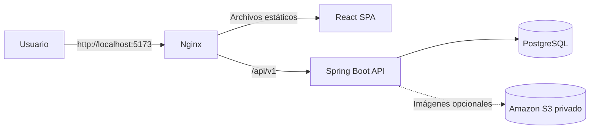
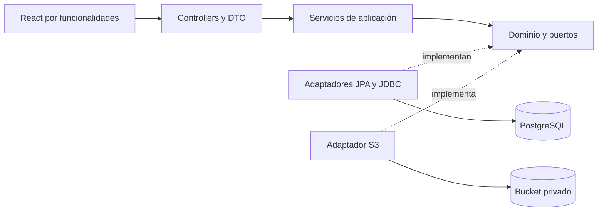
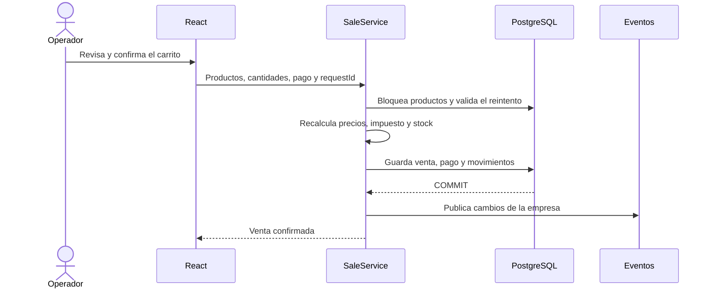
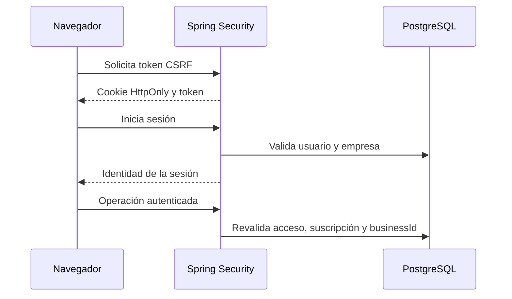
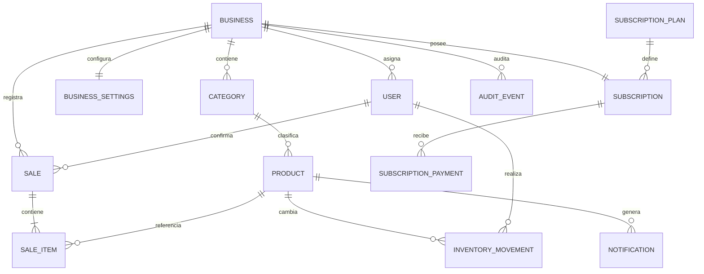

# Kivo

**Español** | [English](README.en.md)

<p align="center">
  
</p>

<p align="center">
  Gestión multiempresa de productos, inventario, ventas y suscripciones.
</p>

Kivo es una aplicación web para administrar la operación diaria de pequeños
comercios. Cada empresa trabaja en un espacio aislado con su propio catálogo,
inventario, ventas, configuración y usuarios. Un panel separado permite administrar
las empresas, los planes y las suscripciones de la plataforma.

El proyecto usa un monolito modular: una interfaz React, una API Spring Boot y una
base de datos PostgreSQL. Puede iniciarse completo con Docker Compose o ejecutarse
por componentes durante el desarrollo.

> [!IMPORTANT]
> Los comprobantes de Kivo son documentos internos. Esta versión no emite boletas
> tributarias electrónicas ni se conecta directamente con SII o terminales de pago.

## Contenido

- [Visión general](#visión-general)
- [Funcionalidades](#funcionalidades)
- [Arquitectura](#arquitectura)
- [Modelo de datos](#modelo-de-datos)
- [Estructura del repositorio](#estructura-del-repositorio)
- [Tecnologías](#tecnologías)
- [Requisitos](#requisitos)
- [Descargar e iniciar](#descargar-e-iniciar)
- [Cómo usar Kivo](#cómo-usar-kivo)
- [Configuración](#configuración)
- [Desarrollo sin Docker](#desarrollo-sin-docker)
- [Pruebas y calidad](#pruebas-y-calidad)
- [Seguridad](#seguridad)
- [Preparación para producción](#preparación-para-producción)
- [Documentación adicional](#documentación-adicional)
- [Licencia](#licencia)

## Visión general

Kivo atiende dos espacios de trabajo:

| Espacio                      | Usuario         | Responsabilidad                                            |
| ---------------------------- | --------------- | ---------------------------------------------------------- |
| Administración de plataforma | `SUPER_ADMIN`   | Empresas, accesos, planes, suscripciones y pagos           |
| Operación comercial          | `BUSINESS_USER` | Productos, inventario, ventas, reportes, alertas y ajustes |

Cada empresa puede operar en uno de estos modos:

| Modo             | Comportamiento                                                       |
| ---------------- | -------------------------------------------------------------------- |
| `POS`            | Registra ventas, pagos internos, comprobantes y movimientos de stock |
| `INVENTORY_ONLY` | Registra salidas de inventario sin crear ventas ni ingresos          |

No existe autorregistro público. El administrador crea la empresa y sus accesos;
la persona recibe una contraseña temporal y debe cambiarla al iniciar sesión.

## Funcionalidades

### Administración de plataforma

- Alta, edición, activación y suspensión de empresas.
- Creación de usuarios comerciales y restablecimiento de accesos.
- Creación y edición de planes.
- Asignación, cambio, suspensión y reactivación de suscripciones.
- Períodos de prueba, vencimientos y días de gracia.
- Registro y confirmación manual de pagos de suscripción.
- Preferencias de tema e idioma.

### Operación de cada empresa

- Categorías y productos con código de barras, precios, imagen y stock mínimo.
- Entradas, salidas, ajustes, devoluciones e historial de inventario.
- Punto de venta con búsqueda por nombre o código de barras.
- Compatibilidad con lectores HID que funcionan como teclado.
- Carrito conservado al navegar dentro de la misma sesión del navegador.
- Venta atómica con validación de precio, stock e idempotencia.
- Cancelación de ventas y restitución de existencias.
- Comprobantes internos imprimibles con el logo de Kivo.
- Reportes por período, productos más vendidos y nivel de existencias.
- Alertas de stock bajo desde la campana de notificaciones.
- Actualización de vistas mediante eventos SSE después de confirmar cambios.
- Tema claro u oscuro e interfaz en español, inglés y chino.
- Diseño responsivo para escritorio, tablet y móvil.

### Reglas relevantes

- Los datos comerciales siempre se consultan con la empresa de la sesión.
- El navegador no envía un identificador de empresa para decidir el alcance.
- Los importes y el impuesto se vuelven a calcular en el servidor.
- Una venta no puede dejar stock negativo.
- Los reintentos con el mismo identificador no duplican ventas ni movimientos.
- Desactivar un producto o categoría conserva su historial.

## Arquitectura

### Topología local



Nginx sirve la aplicación compilada y reenvía las peticiones de API. El navegador
trabaja bajo un mismo origen, mientras el backend y PostgreSQL permanecen en redes
internas de Compose. Los puertos publicados localmente escuchan solo en
`127.0.0.1`.

### Diseño interno



El backend aplica una arquitectura limpia pragmática dentro de un monolito modular:

- **Presentación:** recibe HTTP, valida el formato y transforma DTO.
- **Aplicación:** coordina casos de uso, transacciones y permisos.
- **Dominio:** contiene modelos, reglas y contratos sin depender de JPA.
- **Infraestructura:** implementa persistencia, seguridad, almacenamiento y SSE.

Esta separación permite modificar una regla o reemplazar un adaptador sin trasladar
detalles de infraestructura a los controladores. Se usan inyección por constructor,
repositorios, estrategias de pago, adaptadores y eventos de dominio.

### Módulos del backend

| Módulo          | Responsabilidad                                                         |
| --------------- | ----------------------------------------------------------------------- |
| `auth`          | Inicio y cierre de sesión, CSRF, identidad vigente y límite de intentos |
| `businesses`    | Administración de empresas                                              |
| `users`         | Usuarios, contraseñas temporales y estado de acceso                     |
| `billing`       | Planes, suscripciones, vencimientos y pagos de la plataforma            |
| `categories`    | Clasificación del catálogo                                              |
| `products`      | Productos, precios, búsqueda e imágenes                                 |
| `inventory`     | Existencias, movimientos y salidas confirmadas                          |
| `sales`         | Ventas, detalle, idempotencia y cancelaciones                           |
| `payments`      | Formas de pago de las ventas                                            |
| `documents`     | Comprobantes internos y contrato para un futuro emisor tributario       |
| `reports`       | Consultas agregadas por empresa y período                               |
| `settings`      | Modo de operación, impuestos, scanner y documentos                      |
| `notifications` | Alertas de stock mínimo                                                 |
| `realtime`      | Eventos SSE aislados por empresa                                        |
| `storage`       | Validación y almacenamiento opcional de imágenes                        |
| `shared`        | Errores, paginación, auditoría y utilidades transversales               |

### Flujo de una venta



Si el precio cambió después de revisar el carrito, la API devuelve el total vigente
y exige una nueva confirmación. Los eventos se emiten después del `COMMIT`, por lo
que una vista nunca se actualiza con una operación revertida.

### Sesión y aislamiento



Las sesiones son opacas, se almacenan en PostgreSQL y caducan por inactividad.
Cambiar el estado o la versión de acceso de un usuario invalida sus sesiones
anteriores.

## Modelo de datos



Los detalles de venta guardan copias del nombre, categoría y precio utilizados en
el momento de confirmar. Por eso los reportes históricos siguen siendo coherentes
aunque el catálogo cambie después. Las migraciones Flyway crean y evolucionan este
modelo automáticamente.

## Estructura del repositorio

```text
.
├── backend/
│   ├── src/main/java/com/stockflow/
│   │   ├── auth/                 Autenticación y seguridad
│   │   ├── billing/              Planes y suscripciones
│   │   ├── businesses/           Empresas
│   │   ├── categories/           Categorías
│   │   ├── documents/            Comprobantes
│   │   ├── inventory/            Existencias y movimientos
│   │   ├── notifications/        Alertas
│   │   ├── payments/             Pagos de ventas
│   │   ├── products/             Catálogo
│   │   ├── realtime/             SSE
│   │   ├── reports/              Indicadores
│   │   ├── sales/                Ventas
│   │   ├── settings/             Ajustes comerciales
│   │   ├── storage/              Imágenes
│   │   ├── users/                Usuarios
│   │   └── shared/               Componentes comunes
│   ├── src/main/resources/
│   │   └── db/migration/         Esquema versionado con Flyway
│   └── src/test/                 Pruebas unitarias e integración
├── frontend/
│   ├── public/
│   │   ├── fondos/               Fondos optimizados
│   │   └── logos/                Identidad visual WebP
│   ├── src/
│   │   ├── app/                  Router, providers y shell
│   │   ├── features/             Pantallas agrupadas por negocio
│   │   ├── locales/              Traducciones
│   │   ├── shared/               API, tipos y componentes reutilizables
│   │   └── styles/               Tokens, temas y diseño responsivo
│   └── e2e/                      Recorridos completos con Playwright
├── docs/                         Arquitectura, API y mantenimiento
├── infrastructure/               Guía de despliegue prevista para AWS
├── scripts/                      Preparación local y tareas del backend
├── .github/workflows/ci.yml      Integración continua
├── docker-compose.yml            Entorno local completo
└── .env.example                  Plantilla pública sin secretos
```

El namespace Java `com.stockflow` y algunos identificadores técnicos históricos
se conservan para evitar migraciones innecesarias. La marca presentada en la
interfaz y en la documentación es **Kivo**.

## Tecnologías

| Área            | Tecnologías principales                                                                                  |
| --------------- | -------------------------------------------------------------------------------------------------------- |
| Frontend        | React 19, TypeScript 5.9, Vite 7, React Router, TanStack Query, React Hook Form, Zod, i18next y Recharts |
| Backend         | Java 25, Spring Boot 4.1, Spring Security, Spring Data JPA, Hibernate y Maven                            |
| Datos           | PostgreSQL 17, Flyway y Spring Session JDBC                                                              |
| Infraestructura | Docker Compose, Nginx sin privilegios y adaptador para Amazon S3                                         |
| Calidad         | JUnit, Testcontainers, Vitest, Testing Library, Playwright, ESLint, Prettier y Spotless                  |

## Requisitos

### Opción recomendada

- [Git](https://git-scm.com/)
- [Docker Desktop](https://www.docker.com/products/docker-desktop/) o Docker Engine
  con el complemento Compose
- [Node.js 24 LTS](https://nodejs.org/) para generar la configuración local

### Desarrollo por componentes

Además de lo anterior:

- Java 25
- Maven 3.9
- npm, incluido con Node.js

## Descargar e iniciar

### 1. Descargar el proyecto

```powershell
git clone https://github.com/TU_USUARIO/TU_REPOSITORIO.git
cd TU_REPOSITORIO
```

Reemplaza la URL por la dirección real del repositorio.

### 2. Crear la configuración local

Con Docker Desktop iniciado, ejecuta desde la raíz:

```powershell
node scripts/setup-local.mjs
```

El script crea `.env` una sola vez a partir de [`.env.example`](.env.example),
genera contraseñas aleatorias y no las muestra en la terminal. Si `.env` ya existe,
lo conserva.

### 3. Construir e iniciar Kivo

```powershell
docker compose --profile app up --build -d
```

La primera ejecución puede tardar mientras Docker descarga las imágenes y compila
la aplicación.

### 4. Abrir la aplicación

Visita [http://localhost:5173](http://localhost:5173).

Las credenciales locales están guardadas en `.env`:

- Administrador: `BOOTSTRAP_ADMIN_EMAIL` y `BOOTSTRAP_ADMIN_PASSWORD`.
- Usuario de demostración: `DEMO_USER_EMAIL` y `DEMO_USER_PASSWORD`.

No publiques ni compartas el contenido de ese archivo.

### 5. Comprobar el estado

```powershell
docker compose ps
docker compose logs -f backend frontend
```

La API también ofrece una comprobación pública mínima en
[http://localhost:8080/api/v1/health](http://localhost:8080/api/v1/health).

### Detener o reiniciar

```powershell
docker compose --profile app down
```

Este comando conserva los datos de PostgreSQL. Para volver a iniciar:

```powershell
docker compose --profile app up -d
```

> [!CAUTION]
> `docker compose down -v` elimina el volumen y todos los datos locales. Úsalo
> solo cuando quieras recrear el entorno desde cero.

### Servicios locales

| Servicio   | Dirección                      | Uso                        |
| ---------- | ------------------------------ | -------------------------- |
| Interfaz   | `http://127.0.0.1:5173`        | Aplicación en el navegador |
| API        | `http://127.0.0.1:8080/api/v1` | Desarrollo y diagnóstico   |
| PostgreSQL | `127.0.0.1:5432`               | Herramientas locales       |

Usa siempre `localhost:5173` o siempre `127.0.0.1:5173` durante una sesión. Las
cookies están asociadas al nombre de host y alternarlos puede cerrar el acceso.

## Cómo usar Kivo

### Primer acceso como administrador

1. Inicia sesión con las variables `BOOTSTRAP_ADMIN_*`.
2. Crea o revisa los planes en **Planes**.
3. Crea una empresa y define su período de prueba o suscripción.
4. Crea el usuario de la empresa con una contraseña temporal.
5. Registra y confirma pagos cuando corresponda.
6. Suspende o reactiva accesos desde el panel administrativo.

### Primer acceso de una empresa

1. Inicia sesión con las variables `DEMO_USER_*` o con el acceso creado.
2. Cambia la contraseña temporal si el sistema lo solicita.
3. Revisa **Ajustes**: modo de operación, impuesto, alertas y comprobantes.
4. Crea las categorías y luego los productos.
5. Registra entradas o ajustes para establecer el stock inicial.
6. Confirma ventas en modo `POS` o salidas en modo `INVENTORY_ONLY`.
7. Consulta movimientos, notificaciones y reportes.

El carrito pendiente se conserva al cambiar de pantalla dentro de la pestaña. Una
operación enviada cuyo resultado todavía es incierto también se conserva para
reintentar con el mismo identificador sin duplicar datos.

## Configuración

El repositorio solo incluye una plantilla pública. El archivo `.env` real está
excluido de Git y de los contextos de Docker.

| Variable                                            | Descripción                                      |
| --------------------------------------------------- | ------------------------------------------------ |
| `POSTGRES_DB`                                       | Nombre de la base local                          |
| `POSTGRES_USER`, `POSTGRES_PASSWORD`                | Acceso de PostgreSQL                             |
| `DB_URL`, `DB_USER`, `DB_PASSWORD`                  | Conexión JDBC del backend                        |
| `SPRING_PROFILES_ACTIVE`                            | `dev` habilita los datos locales de demostración |
| `APP_ALLOWED_ORIGIN`                                | Origen exacto autorizado por CORS                |
| `APP_COOKIE_SECURE`                                 | Debe ser `true` cuando la aplicación usa HTTPS   |
| `APP_TRUSTED_PROXIES`                               | Direcciones exactas de proxies autorizados       |
| `BOOTSTRAP_ADMIN_EMAIL`, `BOOTSTRAP_ADMIN_PASSWORD` | Administrador inicial                            |
| `DEMO_USER_EMAIL`, `DEMO_USER_PASSWORD`             | Acceso comercial del perfil `dev`                |
| `VITE_API_URL`                                      | Ruta pública de la API, normalmente `/api/v1`    |
| `AWS_REGION`, `S3_BUCKET`                           | Almacenamiento privado opcional de imágenes      |

Cambiar en `.env` la contraseña de un usuario ya creado no actualiza la contraseña
guardada. Restablece el acceso desde la administración o recrea el volumen si se
trata de un entorno local descartable.

Si `S3_BUCKET` queda vacío, el catálogo funciona sin carga de imágenes. Las
credenciales de AWS se obtienen desde la cadena estándar del SDK o desde un rol y
nunca se envían al frontend.

## Desarrollo sin Docker

### Base de datos

```powershell
docker compose up -d postgres
```

### Backend

Desde la raíz del proyecto:

```powershell
./scripts/backend.ps1 run
```

El script carga `.env` y utiliza Maven instalado o la copia local disponible en
`.tools`.

### Frontend

En otra terminal:

```powershell
cd frontend
npm ci
npm run dev
```

Vite abre la interfaz en `http://127.0.0.1:5173` y reenvía `/api` a
`localhost:8080`.

## Pruebas y calidad

### Backend

Pruebas unitarias rápidas:

```powershell
./scripts/backend.ps1 test
```

Verificación completa, incluido PostgreSQL mediante Testcontainers:

```powershell
./scripts/backend.ps1 verify
```

### Frontend

```powershell
cd frontend
npm ci
npm run format:check
npm run lint
npm test
npm run build
```

### Recorridos de navegador

Con la aplicación local en ejecución:

```powershell
cd frontend
npx playwright install chromium
npm run test:e2e
```

Los archivos de `frontend/e2e/` automatizan acciones reales del usuario en un
navegador: iniciar sesión, navegar, completar formularios y comprobar resultados.
Sirven para detectar fallos entre frontend, API y base de datos que una prueba
aislada no puede observar.

El workflow [`.github/workflows/ci.yml`](.github/workflows/ci.yml) ejecuta controles
de repositorio, formato, lint, pruebas y compilación en cada `push` y
`pull_request`.

## Seguridad

- Cookie de sesión `HttpOnly` y token CSRF para operaciones de escritura.
- Rotación de sesión después del inicio de sesión.
- Sesiones guardadas en PostgreSQL con expiración por inactividad.
- Límite de intentos de acceso.
- Contraseñas almacenadas con hash.
- Autorización por rol y revalidación de usuario, empresa y suscripción.
- Consultas comerciales limitadas por `businessId`.
- Validación y recodificación de imágenes antes de enviarlas a S3.
- Auditoría para operaciones administrativas y comerciales relevantes.
- Secretos locales excluidos mediante `.gitignore` y `.dockerignore`.

La política para comunicar vulnerabilidades está en [SECURITY.md](SECURITY.md).
No abras una incidencia pública con credenciales, tokens o detalles explotables.

## Preparación para producción

La configuración incluida está orientada al desarrollo local. Antes de exponer una
instancia en Internet:

1. No uses el perfil `dev` ni las credenciales de demostración.
2. Guarda contraseñas y claves en un gestor de secretos.
3. Publica únicamente un proxy o balanceador con HTTPS.
4. Configura `APP_COOKIE_SECURE=true`.
5. Define `APP_ALLOWED_ORIGIN` con el origen HTTPS exacto.
6. Mantén el backend y PostgreSQL en redes privadas.
7. Activa TLS hacia PostgreSQL y copias de seguridad verificadas.
8. Restringe IAM y el bucket S3 al mínimo necesario.
9. Ajusta CSP y proxies confiables a la topología final.
10. Ejecuta todas las pruebas en un entorno de staging.

La guía [infrastructure/aws.md](infrastructure/aws.md) describe una topología
posible. El repositorio no crea recursos de nube ni contiene credenciales AWS.

### Archivos que deben publicarse

Se versionan el código, migraciones, pruebas, documentación, recursos WebP,
Dockerfiles, Compose, archivos de bloqueo, workflow de CI, `.env.example` y la
licencia.

No se versionan:

- `.env` ni variantes locales;
- `node_modules`, `dist` y `target`;
- herramientas descargadas en `.tools`;
- resultados de pruebas y cobertura;
- logs, cachés, certificados o claves privadas;
- configuración personal del editor.

Antes de enviar cambios a GitHub:

```powershell
git status --short
git check-ignore -v .env
git diff --cached --name-only
```

`.env` debe aparecer como ignorado y nunca dentro de los archivos preparados. Si
un secreto llegó a confirmarse, rótalo y limpia el historial antes de publicar.

## Documentación adicional

- [Arquitectura y decisiones técnicas](docs/architecture.md)
- [Contrato y rutas de la API](docs/api.md)
- [Guía de mantenimiento](docs/maintenance.md)
- [Interfaz y ciclo de sesión](docs/ui-and-session.md)
- [Verificación y límites conocidos](docs/verification.md)
- [Plan de implementación](docs/implementation-plan.md)
- [Despliegue previsto en AWS](infrastructure/aws.md)

## Licencia

Kivo se distribuye bajo la [licencia MIT](LICENSE). Puedes usar, estudiar, modificar
y redistribuir el código conservando el aviso de copyright y el texto de la licencia.
