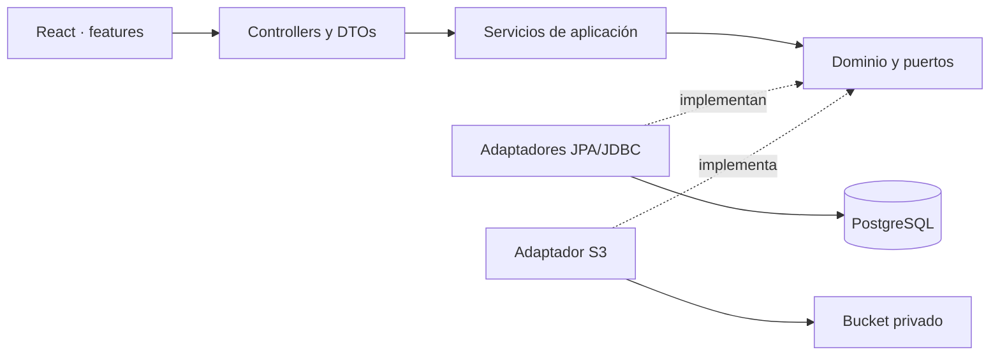
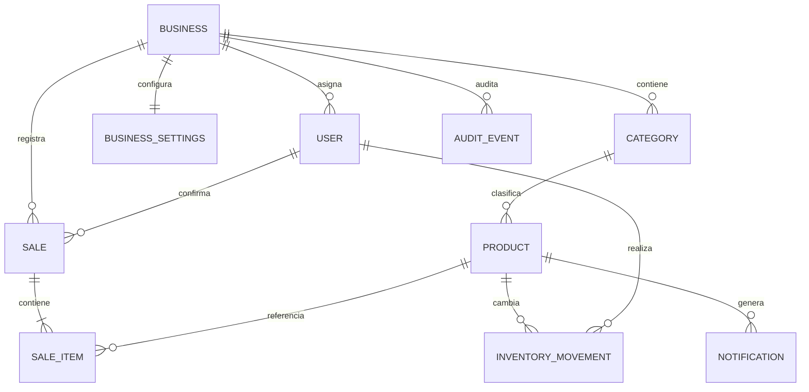
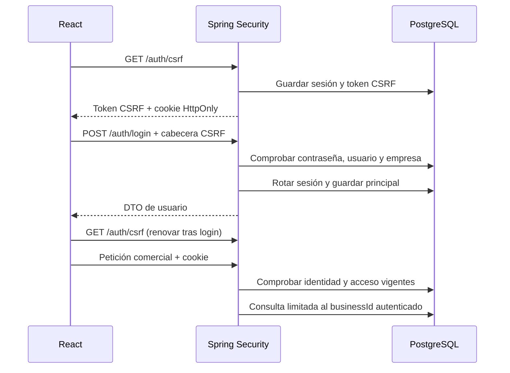
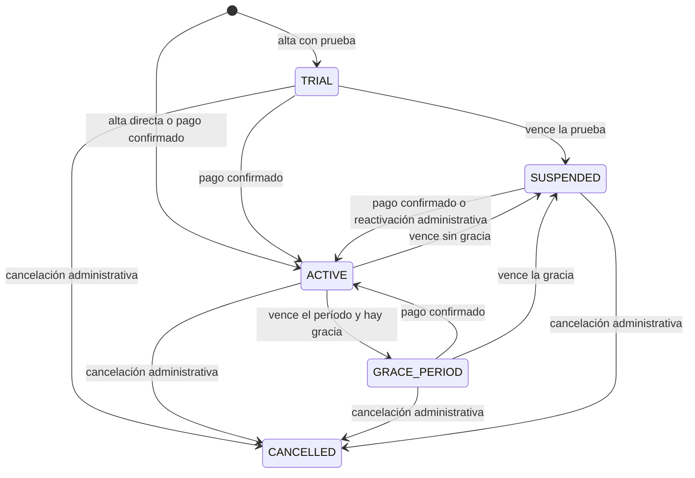
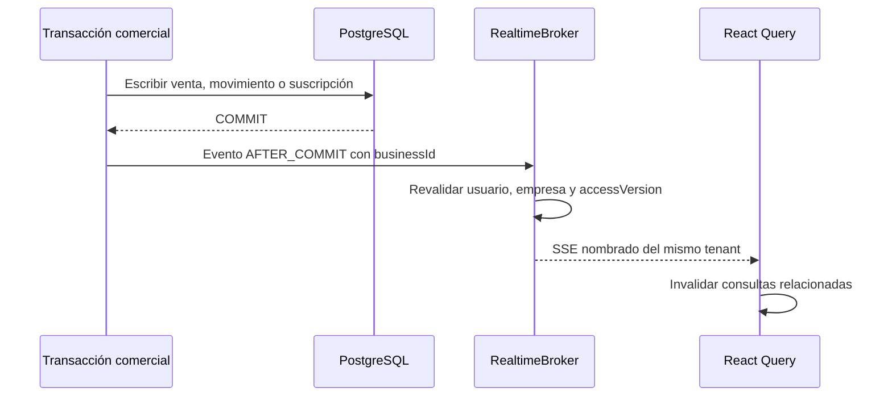
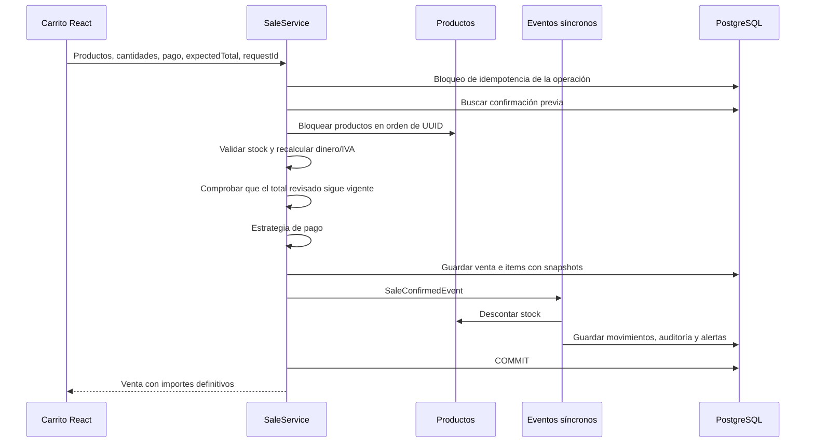

# Arquitectura de Kivo

## Monolito modular

Un único backend desplegable y una sola base PostgreSQL. Los módulos se organizan
por responsabilidades comerciales, con inyección de dependencias por constructor.
Los modelos de dominio son objetos/records Java sin anotaciones JPA. La persistencia
se implementa en `infrastructure` y las peticiones HTTP en `presentation`.



Las anotaciones de Spring en los servicios coordinan transacciones y eventos;
las reglas monetarias y el modelo no necesitan Spring. No se añade un puerto
por cada método trivial. Los repositorios comparten un mecanismo de persistencia
que exige `businessId` en todas las lecturas comerciales.

## Responsabilidades

| Módulo        | Responsabilidad                                             |
| ------------- | ----------------------------------------------------------- |
| auth          | Login, sesión, CSRF, identidad vigente y límite de intentos |
| businesses    | Administración de empresas por la plataforma                |
| users         | Usuarios, roles y restablecimiento/desactivación de accesos |
| billing       | Planes, suscripciones, ciclo de vida y pagos de la plataforma |
| realtime      | Eventos SSE aislados por empresa después del commit         |
| categories    | Clasificación configurable del catálogo                     |
| products      | Datos de producto, precios y búsquedas                      |
| inventory     | Cambios de stock, movimientos y salidas confirmadas         |
| sales         | Confirmación, snapshots, idempotencia y cancelaciones       |
| payments      | Estrategias de efectivo y registro de pago externo          |
| documents     | Emisión de comprobantes internos y puerto SII               |
| reports       | Agregaciones de PostgreSQL por período/empresa              |
| settings      | Modo de operación, impuestos, scanner y documentos          |
| notifications | Alertas internas al alcanzar stock mínimo                   |
| storage       | Validación de imágenes y adaptador S3                       |
| shared        | Errores, paginación, auditoría y mecanismos transversales   |

## Modelo de datos



`sale_items` conserva nombre, precio e identificación del producto y la identidad
y nombre de categoría al vender. Los rankings agrupan por identidad estable;
los snapshots sirven como etiquetas. Las líneas anteriores a la migración de
identidad de categoría conservan su nombre histórico sin inventar su clasificación.
Desactivar categorías/productos no borra historia. Los
movimientos contienen delta, saldo anterior, saldo nuevo, autor y referencia.
Los timestamps son `TIMESTAMPTZ`/`Instant`; los períodos de reporte se convierten
desde la zona horaria de la empresa a instantes UTC.

## Identidad y tenant



La sesión opaca se eligió para una aplicación web del mismo origen. Evita gestionar
access/refresh tokens en JavaScript. Su expiración por inactividad es de 30 minutos.
`accessVersion` revoca sesiones al cambiar acceso; una empresa o usuario desactivado
deja de autorizar peticiones. `SessionIdentity.getName()` devuelve el UUID del usuario
para que la indexación de sesiones no dependa del `toString()` del objeto.

Solo los endpoints administrativos reciben asociaciones de empresa y únicamente
después de autorizar `SUPER_ADMIN`. El catálogo, los movimientos y las ventas no
aceptan `businessId` del cliente. Consultar un ID de otra empresa produce la misma
respuesta que un recurso inexistente.

Las relaciones de stock y ventas utilizan claves compuestas por empresa. No se
permite reasignar a otra empresa un usuario con historia referenciada: se crea
un nuevo acceso para preservar autores y relaciones anteriores. Las empresas
siguen pudiendo activar/desactivar sus accesos mediante la administración global.

RLS no está activado. Para incorporarlo habrá que fijar el tenant con `SET LOCAL`
en cada transacción, crear políticas con `USING` y `WITH CHECK`, usar un rol sin
`BYPASSRLS`, probar el pool de conexiones y tratar explícitamente la administración.
Las claves e índices actuales permiten ese refuerzo; la seguridad presente no lo presupone.

## Suscripciones y acceso comercial

El módulo `billing` es independiente de `payments`: el primero cobra el uso de
Kivo; el segundo representa la forma de pago de una venta del comercio. Una
empresa nueva recibe ajustes y suscripción en la misma transacción. Las empresas
anteriores a la migración conservan acceso mediante el plan heredado.



`ActiveIdentityFilter` aplica la política en el backend antes de llegar a los
controllers comerciales. El navegador nunca decide si una empresa puede operar.
Las transiciones por fecha también se ejecutan en lotes diarios y son idempotentes;
cada cambio guarda un actor humano o `SYSTEM` en auditoría.

Los pagos de suscripción nacen `PENDING`. El comercio no envía el precio: el
backend lo toma del plan. Solo `SUPER_ADMIN` confirma el pago manual y esa misma
transacción activa o extiende el período. `requestId` evita registros duplicados.

## Actualización en tiempo real



No hay broker externo. Cada instancia mantiene sus conexiones SSE en memoria; si
se despliegan varias instancias se necesitará afinidad de sesión o un mecanismo de
distribución antes de prometer eventos entre nodos. La API sigue siendo la fuente
de verdad y el frontend vuelve a consultar al conectarse o reconectarse.

## Confirmación de venta



El bloqueo es pesimista por producto y todos los escritores de stock lo respetan.
La adquisición ordenada evita ciclos entre carritos de varios productos. El índice
único `(business_id, request_id)` y un bloqueo transaccional de la operación
serializan reintentos. Un fingerprint impide reutilizar la misma clave con otro
carrito o pago. Un fallo de un listener se propaga y revierte la transacción completa.

`expectedTotal` es una precondición, no la fuente del cálculo. Si el catálogo o IVA
cambió y el total actual difiere del revisado por el operador, se rechaza con
`PRICE_CHANGED` antes de guardar venta, pago o movimientos. React actualiza la
cotización y exige nueva confirmación del pago.

Antes de enviar una confirmación, el frontend conserva el UUID, endpoint y payload
en `sessionStorage`, separado por usuario, empresa y tipo de operación. No incluye
contraseñas ni cookies. Mientras el resultado sea incierto bloquea su edición y
ofrece recuperar la operación con el mismo contenido. Esto también funciona al
navegar o recargar la pestaña. No constituye un carrito general persistente: solo
se conserva la operación enviada hasta conocer su resultado.

Los reportes consultan SQL agregado; no requieren duplicar métricas mediante un
listener. No se han añadido colas ni consistencia eventual para el stock.

## Scanner e inventario

El lector HID actúa como teclado sobre el campo de búsqueda. `Enter` dispara
una búsqueda de código exacto dentro de la empresa. Un código repetido incrementa
la cantidad del carrito. El ingreso manual sigue disponible.

Las consultas del scanner conservan el foco y procesan los códigos recibidos en
orden. Un Enter sin código no agrega unidades. La latencia de red no debe obligar
al operador a volver a seleccionar el campo después de cada producto.

En POS, escanear no escribe stock. En `INVENTORY_ONLY`, el mismo carrito reúne
productos hasta que se confirma una salida. Esa salida es atómica e idempotente,
registra movimientos y no crea ingresos ni pagos.

En el formulario de ajustes manuales, `ADJUSTMENT` significa **saldo final contado**;
los otros tipos reciben una cantidad positiva de entrada/salida. Se registra el
delta derivado. Las cancelaciones registran movimientos `RETURN` y son idempotentes.
Los movimientos manuales también utilizan un identificador de operación y guardan
su resultado en la transacción, de modo que reintentar una respuesta perdida no
vuelve a aplicar el delta.

Las alertas se generan al cruzar el umbral mínimo y al llegar a cero, para evitar
un aviso repetido en cada venta mientras un producto ya está bajo el mínimo. La
lista de productos con stock bajo se consulta siempre a partir del saldo actual.

## Patrones y SOLID

- **Repository**: puertos del dominio y adaptadores JPA/JDBC. Los controllers no
  conocen entidades JPA ni construyen consultas.
- **Strategy**: efectivo y pago externo comparten `PaymentStrategy`; `PaymentService`
  selecciona una implementación por composición.
- **Adapter**: `StorageAdapter`, `PaymentTerminalAdapter` y `SiiDocumentAdapter`.
- **Observer/Eventos**: venta confirmada → movimientos → aviso de stock bajo,
  dentro de una transacción síncrona.
- **Emisor de documentos**: `DocumentIssuer` permite sustituir el comprobante
  interno. Una Factory adicional todavía no aporta valor con un solo emisor real.

La responsabilidad única se aplica por caso de uso; las interfaces pequeñas permiten
extensiones sin subclases comerciales. No hay `ProductoBebida` ni `UsuarioCajero`.
Los records inmutables y validaciones mantienen los cambios explícitos.

## Imágenes

El usuario autorizado envía JPEG/PNG al backend. Se limita tamaño y dimensiones,
se vuelve a codificar la imagen y se genera una clave propia del servidor:

```text
businesses/{businessId}/products/{productId}/{uuid}.png
```

El bucket es privado. La consulta de imagen verifica el producto y tenant antes
de generar una URL de lectura de cinco minutos. PostgreSQL guarda únicamente la
clave. El SDK utiliza credenciales de backend/rol IAM. Si S3 falla, la operación
informa el error; no se simula una subida correcta.

La escritura S3 y PostgreSQL no forman una transacción distribuida. Un fallo de
base posterior a la subida puede dejar un objeto huérfano; debe gestionarse con
reconciliación/lifecycle antes de habilitar grandes volúmenes de imágenes. Las
URLs prefirmadas son enlaces temporales de acceso al objeto, no tokens de sesión.

## Frontend

React Router carga páginas de forma diferida. TanStack Query controla los datos
del servidor y su invalidación después de mutaciones. El carrito usa un reducer
local; React Hook Form y Zod validan formularios, mientras el backend vuelve a
validar todo lo importante.

`styles/tokens.css` define colores y temas. `styles/global.css` contiene layout,
breakpoints y reglas de impresión. El sidebar pasa a panel móvil; las tablas
mantienen scroll horizontal interno. Los diálogos nativos gestionan foco y Escape.
Las etiquetas y estados se traducen con claves; los datos de clientes no se traducen.
