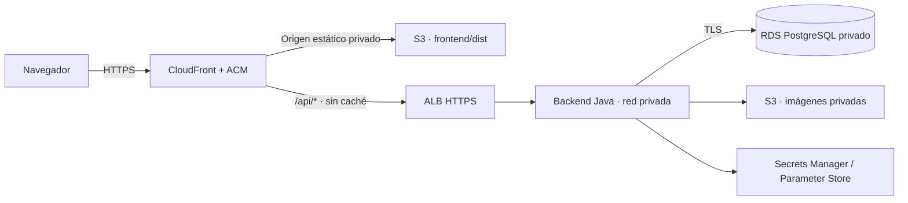

# Despliegue previsto en AWS

Esta guía describe la configuración necesaria. No crea recursos ni declara que
el workspace esté desplegado. El entorno local usa HTTP en localhost; producción
debe usar HTTPS y cookies Secure.

## Topología

Puede ejecutarse el monolito en una instancia o servicio de contenedores. No se
necesita Kubernetes. Mantén la API y frontend bajo el mismo origen público para
simplificar cookies y CSRF.

## Dominio y TLS

1. Configura un dominio propio y su DNS hacia CloudFront.
2. Solicita el certificado del dominio para CloudFront en ACM `us-east-1` y valida
   el dominio. El certificado del ALB corresponde a la región de ese ALB. Consulta
   [los requisitos de certificados de CloudFront](https://docs.aws.amazon.com/AmazonCloudFront/latest/DeveloperGuide/cnames-and-https-requirements.html).
3. Configura redirección HTTP → HTTPS para viewers y conexión HTTPS al origen API.
4. Define `APP_ALLOWED_ORIGIN=https://tu-dominio` y `APP_COOKIE_SECURE=true`.
5. Añade HSTS en la respuesta pública, además de CSP, nosniff, política de referer
   y frame-ancestors. Adapta la política CSP de `frontend/nginx.conf` al hostname
   exacto del bucket de imágenes utilizado.

## Frontend y caché

Construye `frontend/dist`. Publica únicamente su contenido, excluyendo sourcemaps,
`.env`, código fuente y credenciales. Usa S3 privado con Origin Access Control,
según [la guía oficial OAC](https://docs.aws.amazon.com/AmazonCloudFront/latest/DeveloperGuide/private-content-restricting-access-to-s3.html).

`/assets/*` puede cachearse por un año porque sus nombres contienen hash.
`index.html` debe revalidarse. Para rutas de React Router, reescribe únicamente las
rutas de navegación del origen estático a `/index.html`. No conviertas errores
401/403/404 de `/api/*` en HTML.

Para `/api/*`, desactiva caché, permite los métodos necesarios y reenvía cookies,
`Content-Type` y `X-CSRF-TOKEN`. Las respuestas autenticadas, CSRF y Set-Cookie no
pueden compartirse entre usuarios. Conserva el origen esperado por CORS.

## Backend y PostgreSQL

- RDS PostgreSQL en subred privada; acceso limitado al grupo de seguridad del backend.
- Conexión JDBC TLS con validación del certificado: `sslmode=verify-full` y el
  certificado raíz de RDS configurado en el contenedor.
- Backups automáticos, retención, recuperación a un punto en el tiempo y prueba de restauración.
- Rol de migraciones separado del rol de aplicación. Este último no debe ser
  superusuario ni tener `BYPASSRLS`; concede únicamente los permisos necesarios.
- Ejecuta migraciones como paso controlado previo al despliegue. Spring permite
  credenciales específicas mediante `SPRING_FLYWAY_USER`/`SPRING_FLYWAY_PASSWORD`.
- No actives el perfil `dev`. Suministra secretos desde el servicio de despliegue,
  Secrets Manager o Parameter Store; el proyecto acepta variables externas, pero
  todavía no incorpora un cliente que rote secretos automáticamente en ejecución.
- El backend ignora `X-Forwarded-For`. Para el límite de login, configura
  `APP_TRUSTED_PROXIES` con las IP exactas de los proxies autorizados y haz que
  esos proxies **sobrescriban** `X-StockFlow-Client-IP` con la IP validada del visitante.
  La lista está vacía por defecto. Compose usa una red dedicada y Nginx en
  `172.30.0.10`; si cambias esa red, cambia también la lista del backend.
  Nunca configures esta cabecera con el valor libre enviado por el navegador.

El limitador de login del MVP es local al proceso: 20 intentos por IP en 15 minutos,
con mapa acotado. La IP normalizada del proxy evita que todos sus visitantes
consuman el mismo contador. En AWS configura además un límite en WAF usando la IP
real del visitante; al escalar a varias instancias el límite debe compartirse en
el borde. Un ALB directo no genera la cabecera propia del ejemplo Nginx: adapta
la resolución de IP a la topología y sus proxies confiables antes de publicar.
Las sesiones ya se comparten en PostgreSQL.

## Imágenes privadas

Define `S3_BUCKET` y `AWS_REGION`. Concede al rol de ejecución únicamente
`s3:PutObject` y `s3:GetObject` sobre el prefijo previsto del bucket. No requiere
permisos de administración, acceso público ni credenciales en el frontend.
El ejemplo [s3-image-policy.json](s3-image-policy.json) debe adaptarse al bucket real.

Activa Block Public Access y cifrado. El backend admite JPEG/PNG de hasta 5 MB,
comprueba dimensiones y recodifica antes de subir. La descarga usa URLs firmadas
de cinco minutos después de autorizar el producto. No registres esas URLs en logs.
La revocación de acceso al usuario no invalida inmediatamente un enlace ya emitido:
expira a los cinco minutos. Para revocación inmediata, sirve imágenes mediante
un proxy autenticado en lugar de enlaces firmados.

Prepara reconciliación de objetos huérfanos y tratamiento de versiones sustituidas.
No apliques una regla que borre todas las imágenes por antigüedad: debe distinguir
los objetos que siguen referenciados por productos.

## Antes de publicar

Ejecuta las suites de pruebas y revisa [README.md](../README.md) y
[SECURITY.md](../SECURITY.md). Verifica orígenes, cookies Secure, TLS hacia los
orígenes y PostgreSQL, CSP, secretos externos, backups y permisos IAM. El adaptador
S3 necesita una prueba con un bucket de
staging: las pruebas locales no certifican la configuración de una cuenta AWS.
